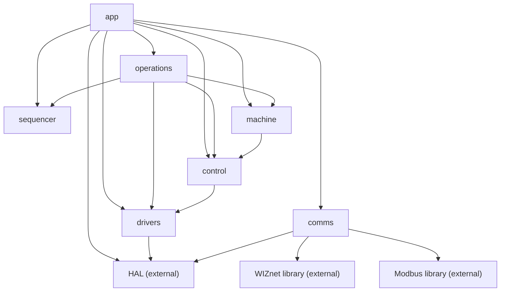
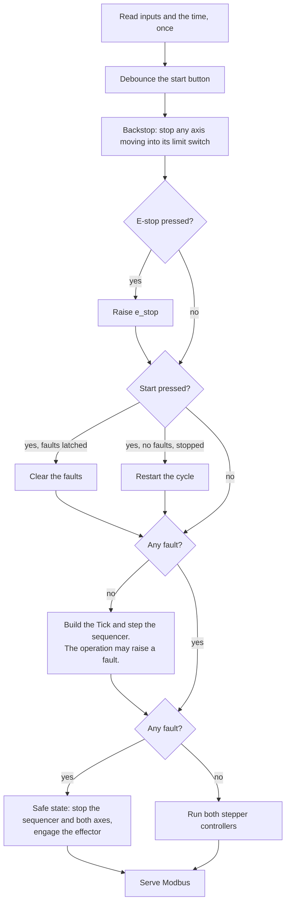

# App

The application code, split into layers. Each folder is one layer, and a layer may
only include from the layers it depends on.

[`CMakeLists.txt`](CMakeLists.txt) declares these dependencies with
`target_link_libraries()`, and the compiler enforces them: including a header from
a layer you don't depend on is a build error. To add a file, list it under its layer
there, and include other files by name alone. `machine` and `sequencer` contain only
headers, so they're declared with `add_app_header_layer()`.

## The mental model

- **Inputs** are what the hardware says this pass: which buttons and switches are pressed.
  Which signals exist is a hardware decision. How a pin is read stays in `read_inputs()`.
- **Capabilities** are the small pieces of software that give the hardware abilities it
  doesn't have on its own. A `StepperController` gives a pulse train position control,
  and an `Axis` bundles one controller with its scale, its switch and its fault codes.
- **Operations** are written against capabilities, not against pins or this machine's
  cycle. A move knows it drives *an* axis, not that it's X.
- **The sequencer** runs a list of operations that all take the same context. It knows
  nothing else.
- **`app`** wires one concrete machine together: which axis is X, which switch is its,
  what the cycle is, and what Modbus shows.

## One loop pass

`loop()` in [`app/entrypoint.cpp`](app/entrypoint.cpp) runs this, top to bottom, on
every pass:

Two things follow from this order:

- **A fault acts on the pass it's raised.** An operation that raises a fault is
  followed by the safe state on the same pass, before any controller runs again.
- **Safety doesn't depend on the operations.** The e-stop and the limit backstop run
  before the sequencer, whatever operation is running and even if it's buggy.

## Per pass vs fixed

An operation's dependencies are all in its signature. Which of the two places a
value goes depends on how often it changes:

| Changes | How it reaches the operation | Examples |
|---|---|---|
| Every pass | The `Tick` passed to `start()` and `poll()` | `now_ms`, the input snapshot, `Faults` to raise into |
| Never, for the life of the program | The constructor, usually through an `Axis` | The controller, the scale, which switch, which faults to raise |
| When Modbus writes it | A `const &` to a `Recipe` field, read only in `start()` | Positions, the dwell time |

An operation never stores a value that changes every pass, and never reads a clock
or a pin.

## Faults: who raises what

There is one list of faults, `Fault` in [`machine/faults.hpp`](machine/faults.hpp).
Its order is the bit layout on Modbus.

| Fault | Raised by | Why there |
|---|---|---|
| `e_stop` | `loop()` | It doesn't depend on what's running |
| `x_limit_hit`, `y_limit_hit` | `MoveStepperOperation` | Only the operation knows a switch wasn't expected |
| `x_homing_failed`, `y_homing_failed` | `HomeStepperOperation` | Only homing knows where the switch should be |
| `operation_timed_out` | `HomeStepperOperation` | Only it knows how long it should take |
| `operation_interrupted` | `MoveStepperOperation` | A move cut short for any other reason |

- **Raising:** whoever knows that something differed from the expected behavior raises
  it. `Faults::raise()` latches the first fault, whoever calls it.
- **Clearing:** only `loop()` clears, on a start press with the e-stop released.
- **Reacting:** only `loop()` reacts, by entering the safe state while any fault is latched.
- **The same switch, two meanings:** the backstop in `loop()` stops an axis moving
  into its switch, but never decides what that means. A move reports it as a limit
  hit. Homing expects it.

## Layers

### `drivers`: how do I talk to this board?

Wraps the timers and GPIO, and defines which pins and channels the board uses.

- **May use:** the HAL.
- **Rules:**
  - Do what you're told, with no knowledge of the process or of motion profiles.
  - Interrupt code stays short, and shares state with the main loop only through atomics.
  - Pin assignments and electrical conventions stop here. Nothing above deals in pin levels.

### `control`: how should this axis move over time?

Turns a request like "go to this position" into a speed over time.

- **May use:** `drivers`.
- **Rules:**
  - Receive the current time as an argument, and don't read a clock.
  - Stay unaware of the sequence, the operations and Modbus.

### `machine`: what does this machine have to work with?

The vocabulary shared by the operations and `app`: the input snapshot, the faults, and
the bindings that give operations their capabilities. Types only, with no instances.

| File | What it holds |
|---|---|
| [`inputs.hpp`](machine/inputs.hpp) | `Inputs`: the input levels for one pass |
| [`faults.hpp`](machine/faults.hpp) | `Fault` (the bit layout on Modbus) and `Faults` (what's latched) |
| [`tick.hpp`](machine/tick.hpp) | `Tick`: what every operation receives on each pass |
| [`axis.hpp`](machine/axis.hpp) | `Axis`: one axis's controller, scale, switch and fault codes |

- **May use:** `control`.
- **Rules:**
  - Types only. Which axis is X, and the objects themselves, belong in `app`.
  - No pins: `Inputs` says what a signal means, not how it's read.
  - Limit switches are at the negative end of each axis. Homing and the backstop
    rely on it.

### `sequencer`: how do I run a list of steps?

Runs steps in order, and defines the interface a step must implement. Both are
templates over the context the steps receive, so this layer names nothing of this
machine. See [Templates and explicit instantiation](#templates-and-explicit-instantiation).

- **May use:** nothing.
- **Rules:**
  - Stay generic: no knowledge of steppers, effectors, faults or this machine.
  - Pass the context through to the current operation, and never look inside it.
  - Stop on an operation that returns `aborted`, and keep the index on it.

### `operations`: what kinds of step exist?

Reusable steps built on capabilities, such as moving an axis or waiting.

- **May use:** `sequencer`, `machine`, `control`, `drivers`.
- **Rules:**
  - Follow the rules on `Operation` in [`sequencer/operation.hpp`](sequencer/operation.hpp).
  - Derive from `Operation<Tick>`. Take the time and the inputs from the `Tick`, never
    from the HAL.
  - Take fixed values through the constructor, an axis as an `Axis`. Don't know this
    machine's cycle or its positions.
  - Raise the fault that explains a failure before returning `aborted`, and never
    return `finished` after raising one.
  - Don't reach for global hardware objects.

### `comms`: how do bytes get on and off the network?

Brings up the Ethernet chip and connects its sockets to the Modbus library.

- **May use:** the HAL, the WIZnet library, the Modbus library.
- **Rules:**
  - Stay unaware of this machine. What the registers mean belongs in `app`.
  - Never block: everything advances one step per loop pass.

### `app`: what is this machine, and what does it do?

The top level, which is the only layer that knows the whole machine: its shared state,
its axes, its cycle, its Modbus registers and the main loop.

| File | What it holds |
|---|---|
| [`machine.hpp`](app/machine.hpp) | `Machine`: the inputs, recipe, faults, controllers, axes and sequencer |
| [`sequence.cpp`](app/sequence.cpp) | The operations and the cycle. The only file that knows which operations exist |
| [`sequencer_instance.cpp`](app/sequencer_instance.cpp) | The one compiled copy of `Sequencer<Tick>` |
| [`entrypoint.cpp`](app/entrypoint.cpp) | `read_inputs()`, the only place that knows pins, and `loop()` |
| [`modbus_map.cpp`](app/modbus_map.cpp) | What each Modbus address means |

- **May use:** everything above.
- **Rules:**
  - `loop()` decides who acts in each pass, and safety checks come before the sequencer.
  - `loop()` raises the faults that don't depend on what's running, and is the only
    place that clears them or reacts to them.
  - Read inputs once per pass, and use those values for the rest of the pass.
  - The array in `sequence.cpp` defines the operation index on Modbus. Its order is
    copied into [`docs/modbus-map.md`](../docs/modbus-map.md) and the monitor.

### `experiments`: old bring-up code

Not part of the build, and may not compile. Nothing should depend on it.

## Templates and explicit instantiation

`Operation<Context>` and `Sequencer<Context>` are templates, so the sequencer layer
doesn't name `Tick`. The sequencer's logic still stays out of the header, and is
compiled once:

| File | Holds | Included by |
|---|---|---|
| [`sequencer/sequencer.hpp`](sequencer/sequencer.hpp) | The class, with declarations only | Anyone who uses a sequencer |
| [`sequencer/sequencer_impl.hpp`](sequencer/sequencer_impl.hpp) | The definitions | Only the instantiating file |
| [`app/sequencer_instance.cpp`](app/sequencer_instance.cpp) | `template class Sequencer<Tick>;` | Nobody: it's compiled on its own |

[`app/sequence.hpp`](app/sequence.hpp) declares `extern template class Sequencer<Tick>;`,
so the files that include it use that one copy.

- **Symptom of a missing instantiation:** a link error, not a compile error, such as
  `undefined reference to Sequencer<Tick>::step(Tick&)`. Check that
  `sequencer_instance.cpp` is listed under `app` in [`CMakeLists.txt`](CMakeLists.txt).
- **Another context**, for example a fake one in a host test, gets its own file with
  its own `template class Sequencer<FakeContext>;`.

## Checklists

### Adding an operation

1. Derive from `Operation<Tick>` in `operations/`, and list its `.cpp` under
   `operations` in `CMakeLists.txt`.
2. Take fixed things through the constructor: an `Axis`, a driver, a `const &` to a
   recipe field. Delete the rvalue overloads of any reference you store.
3. In `start()`, reset all per-run state and copy any recipe value you need later.
4. In `poll()`, use only the `Tick` for time and inputs. On a failure, raise the
   fault and return `aborted`.
5. Add it to the array in `app/sequence.cpp`, then update the operation index table in
   `docs/modbus-map.md` and `STAGES` in `tools/modbus_monitor/index.html`.

### Adding a fault

1. Add it to `Fault` in `machine/faults.hpp`, right above `count`, so the existing bits
   keep their numbers. There's room for 16.
2. Raise it where the knowledge is: in `loop()` if it doesn't depend on what's running,
   or in the operation otherwise. For a per-axis fault, add it to `Axis`.
3. Add its row to the faults table in `docs/modbus-map.md`.
4. Add its name to `FAULTS` in `tools/modbus_monitor/index.html`, and to
   `OPERATION_FAULTS` if an operation raises it.

## Limits of the enforcement

- **Dependencies carry upward:** a layer also sees whatever its dependencies expose,
  so a layer could skip a level without an error. Downward dependencies are still
  allowed; what fails is one pointing upward or sideways.
- **The HAL is still visible above `drivers`:** `effector_driver.hpp` and
  `stepper_driver.hpp` include it, so `control`, `machine` and `operations` can see
  it. None of them link or include it directly, and they shouldn't call it.
- **Relative paths get around it:** `#include "../app/..."` would compile, so don't
  write those.
