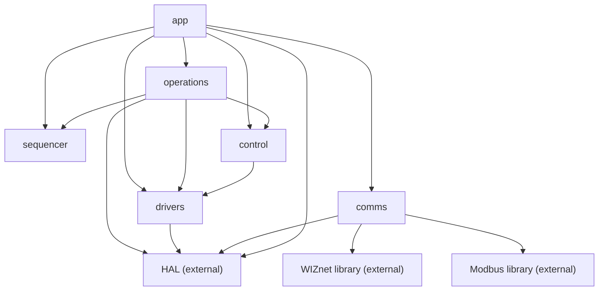

# App

The application code, split into layers. Each folder is one layer, and a layer may
only include from the layers it depends on.

[`CMakeLists.txt`](CMakeLists.txt) declares these dependencies with
`target_link_libraries()`, and the compiler enforces them: including a header from
a layer you don't depend on is a build error. To add a file, list it under its layer
there, and include other files by name alone.

## Layers

### `drivers`: how do I talk to this board?

Wraps the timers and GPIO, and defines which pins and channels the board uses.

- **May use:** the HAL.
- **Rules:**
  - Do what you're told, with no knowledge of the process or of motion profiles.
  - Interrupt code stays short, and shares state with the main loop only through atomics.
  - Pin assignments and electrical conventions stop here. Nothing above deals in pin levels.

### `control`: how should this axis move over time?

Turns a request like "go to this position" into a speed over time.

- **May use:** `drivers`.
- **Rules:**
  - Receive the current time as an argument, and don't read a clock.
  - Stay unaware of the sequence, the operations and Modbus.

The headers in `drivers` currently bring the HAL with them, so this layer can see it.
It shouldn't call the HAL directly.

### `sequencer`: how do I run a list of steps?

Runs steps in order, and defines the interface a step must implement.

- **May use:** nothing.
- **Rules:**
  - Stay generic: no knowledge of steppers, effectors or this machine.
  - Report that a step failed and why, and leave what to do about it to someone above.
    Failure reasons stay generic, and nothing here stores them.

### `operations`: what kinds of step exist?

Reusable steps built on the actuators, such as moving an axis or waiting.

- **May use:** `sequencer`, `control`, `drivers`, the HAL.
- **Rules:**
  - Follow the rules on the `Operation` interface in `sequencer`.
  - Take values through the constructor. Don't know this machine's cycle or its positions.
  - Don't reach for global hardware objects.

### `comms`: how do bytes get on and off the network?

Brings up the Ethernet chip and connects its sockets to the Modbus library.

- **May use:** the HAL, the WIZnet library, the Modbus library.
- **Rules:**
  - Stay unaware of this machine. What the registers mean belongs in `app`.
  - Never block: everything advances one step per loop pass.

### `app`: what is this machine, and what does it do?

The top level, which is the only layer that knows the whole machine: its shared state,
its cycle, its Modbus registers and the main loop.

- **May use:** everything above.
- **Rules:**
  - `loop()` decides who acts in each pass, and safety checks come before the sequencer.
  - `loop()` is the only place that raises and clears faults, and it turns an operation's
    generic failure into a fault of this machine.
  - Read inputs once per pass, and use those values for the rest of the pass.
  - Only one file here knows which operations exist. Everything else sees the sequencer.

### `experiments`: old bring-up code

Not part of the build, and may not compile. Nothing should depend on it.

## Limits of the enforcement

- **Dependencies carry upward:** a layer also sees whatever its dependencies expose,
  so a layer could skip a level without an error. Downward dependencies are still
  allowed; what fails is one pointing upward or sideways.
- **Relative paths get around it:** `#include "../app/..."` would compile, so don't
  write those.
